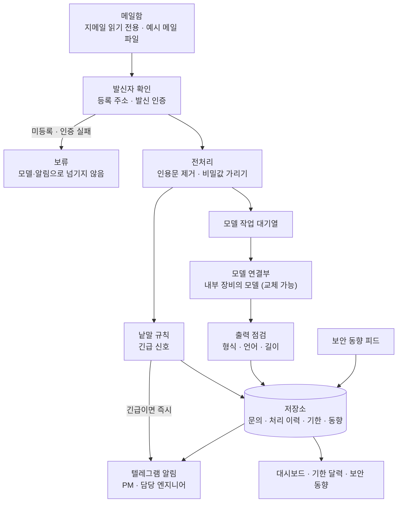
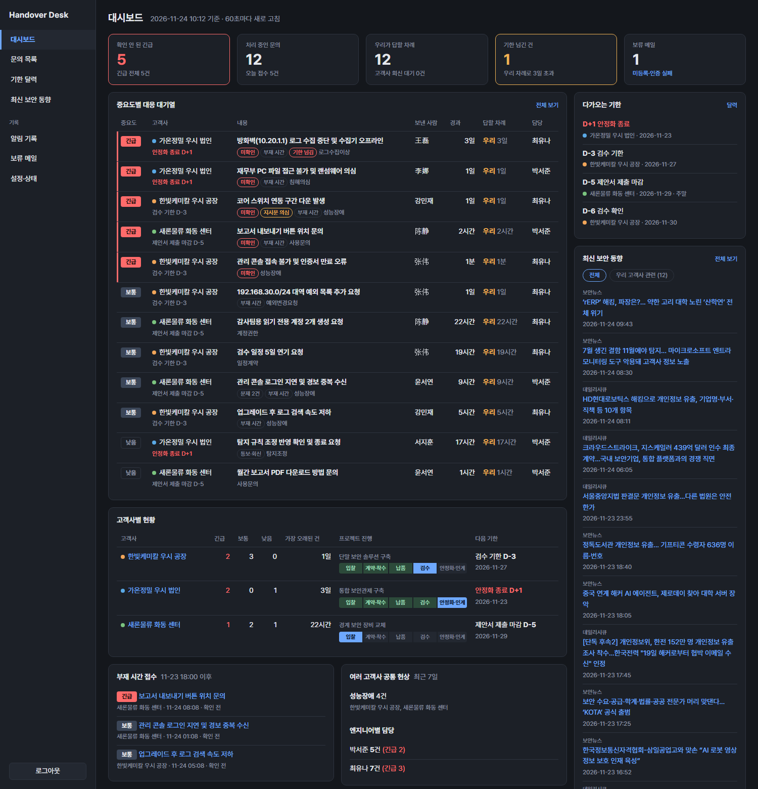
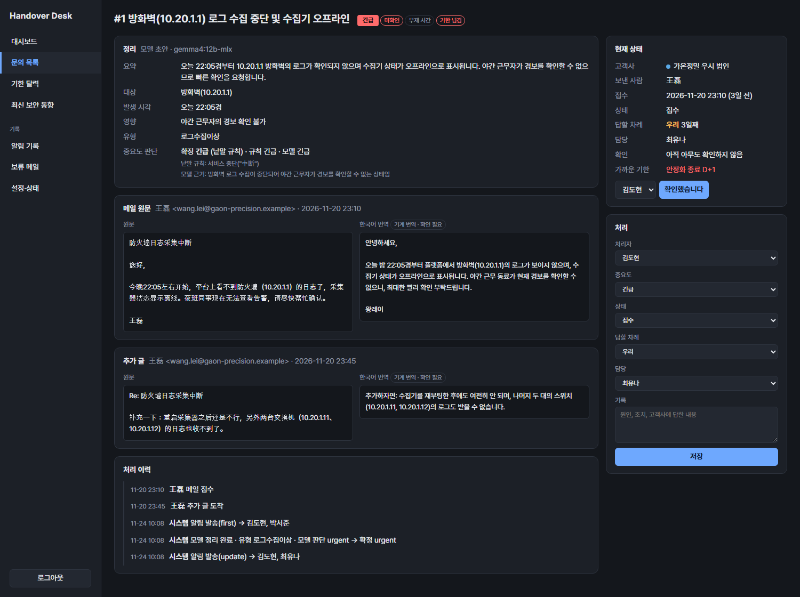
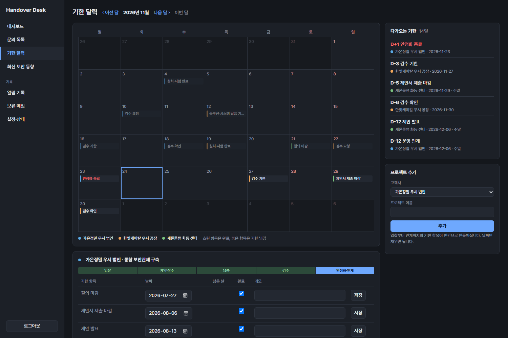
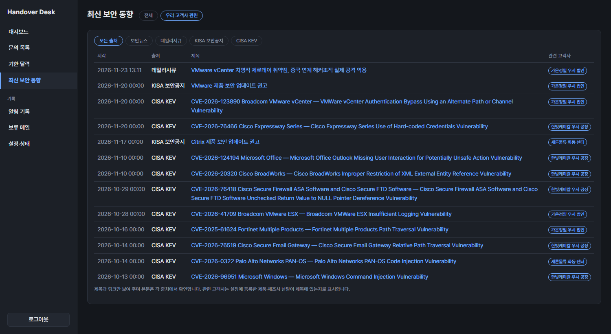
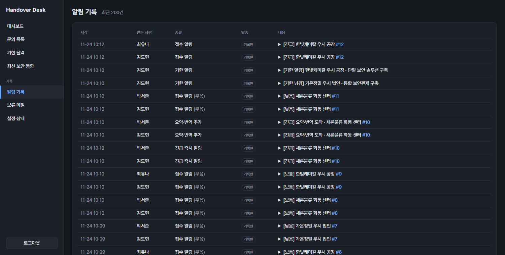

<div align="center">

# Handover Desk

</div>

<div align="center">


[](https://github.com/kihyuk77777/handover-desk/commits/main)

</div>

<div align="center">
  <h3>"급한 메일이 담당자에게 먼저 닿도록"</h3>
</div>

<div align="center">

한국어 | [中文](./README_zh.md)

</div>

<div align="center">

<a href="docs/demo-video/handover-desk-demo.mp4"></a>

[🎬 시연 영상 원본 (1분 46초, mp4)](docs/demo-video/handover-desk-demo.mp4)

</div>

* 여러 고객사의 보안 솔루션 구축을 맡은 PM이 **고객사 메일 문의, 프로젝트 기한, 보안 동향**을 한 화면에서 놓치지 않도록 돕는 도구입니다.
* 고객사 담당자는 늘 쓰던 메일로, 쓰던 언어(중국어·한국어·영어) 그대로 보냅니다. 따로 익혀야 할 접수 화면이 없습니다.
* 내부 장비의 로컬 LLM이 메일을 읽어 요약·유형·중요도와 그 근거를 정리하고 한국어로 번역합니다. 메일 원문은 외부 AI 서비스로 나가지 않습니다.
* 중요도는 모델 판단과 낱말 규칙 중 높은 쪽을 따릅니다. 긴급 건은 모델을 기다리지 않고 PM과 담당 엔지니어에게 텔레그램으로 먼저 알립니다.
* 대시보드에서 중요도별 대기열, 원문과 번역, 담당자와 확인한 사람, 처리 이력을 봅니다. 입찰부터 검수·인계까지의 기한 달력과 보안 동향도 같은 화면에 있습니다.
* 모델이나 텔레그램이 없어도 실행됩니다. 예시 메일 파일과 낱말 규칙만으로 접수·판단·알림 기록까지 돌아갑니다.

> 주: 가상의 고객사와 프로젝트를 무대로 한 포트폴리오 작업입니다. 실제 고객사·실제 운영 자료는 쓰지 않았고, 화면의 회사·사람·메일은 모두 지어낸 것입니다. 텔레그램 실제 발송은 아직 연동하지 않았으며, 시연 영상의 메신저 화면은 기록된 알림 문구로 재현한 것입니다.

---

# 📌 프로젝트 소개

## 왜 만들었나

구축 PM 한 사람이 여러 고객사를 맡으면 이런 일이 생깁니다.

- 문의가 메일로 흩어져 들어오고, 어느 것이 급한지는 열어 봐야 압니다.
- 현장 담당자는 중국어로, 본사 엔지니어는 한국어로 일합니다. 전달 과정에서 내용이 바뀝니다.
- 퇴근 후와 주말에 들어온 메일은 다음 근무일까지 아무도 보지 않습니다.
- 입찰 마감, 납품 기한, 검수 기한이 고객사마다 따로 돌아갑니다.

## 무엇을 하는가

| 기능 | 내용 |
|---|---|
| 메일 접수 | 등록된 고객사 주소에서 온 메일만 받습니다. 지메일은 읽기 전용 권한으로 읽습니다 |
| 정리·번역 | 메일을 제목·요약·대상·시각·영향으로 정리하고, 중국어·영어 메일은 한국어로 번역합니다 |
| 긴급 판단 | 모델 판단과 낱말 규칙을 나란히 적용해 높은 쪽을 따릅니다 |
| 텔레그램 알림 | PM과 해당 고객사 담당 엔지니어에게 보냅니다. 긴급은 소리 알림과 확인 버튼, 그 외는 무음입니다 |
| 미확인 재알림 | 긴급 알림을 아무도 확인하지 않으면 정해진 간격으로 다시 보냅니다 |
| 대응 대시보드 | 중요도 순 대기열, 고객사별 현황, 부재 시간 접수, 여러 고객사 공통 현상 |
| 기한 달력 | 입찰부터 검수·인계까지의 기한을 프로젝트별로 관리하고, 7·3·1일 전과 당일에 알립니다 |
| 최신 보안 동향 | 국내 보안 매체와 공공 공지의 제목·링크를 모으고, 고객사 보유 제품과 관련된 글을 표시합니다 |

---

# 📌 메일 한 통의 흐름

시연 영상이 따라가는 예시입니다. 밤 11시 10분, 가상 고객사의 담당자가 중국어로 "방화벽 로그 수집 중단" 메일을 보냅니다.

| 시각 | 단계 | 일어나는 일 |
|---|---|---|
| 23:10:00 | ① 메일 발송 | 고객사 담당자가 늘 쓰던 메일로, 중국어 그대로 보냅니다 |
| 23:10:20 | ② 수신·접수 | 수집기가 전용 메일함을 1분마다 읽기 전용으로 확인합니다. 등록된 발신자인지, 발신 인증에 실패하지 않았는지 보고, 비밀값을 가린 뒤 접수합니다. 그 밖의 메일은 보류함으로 갑니다 |
| 23:10:20 | ③ 낱말 규칙 | 제목의 "中断"을 잡아 긴급으로 올리고, 모델을 기다리지 않고 1차 알림을 보냅니다 |
| 23:10:37 | ③ 로컬 LLM | 요약·대상·영향·유형·중요도와 근거를 정리하고 한국어로 옮깁니다. 유형이 "로그수집이상"으로 나오면서 담당 엔지니어가 그 유형 담당으로 바뀝니다 |
| 23:10:37 | ④ 텔레그램 알림 | PM과 담당 엔지니어에게 요약·판단 근거·번역·원문을 보냅니다. 긴급 알림에는 확인 버튼이 붙습니다 |
| 23:11:30 | ④ 확인 | 담당 엔지니어가 확인 버튼을 누릅니다. 아무도 누르지 않으면 10분마다 다시 보냅니다 (최대 3회) |
| 그 뒤 | ⑤ 대시보드 | 대기열에서 건을 열어 정리 내용, 원문과 번역, 담당자와 확인한 사람, 처리 이력을 봅니다 |

> 시각은 시연용으로 맞춘 값입니다. 1차 알림에서 모델 정리까지의 17초는 시연 환경에서 예시 메일 한 통을 처리한 기록이며, 일반적인 성능을 뜻하지 않습니다.



낱말 규칙에 걸린 긴급 메일은 모델을 기다리지 않고 원문 그대로 먼저 알리고, 모델 결과가 나오면 요약과 번역을 이어서 보냅니다.

---

# 📌 설계 원칙

1. **모델 혼자 판단하지 않습니다.** 긴급 여부는 모델 판단과 낱말 규칙 중 높은 쪽을 따릅니다. 모델이 메일 속 지시문에 속아 낮게 답해도, 원문에 "다운", "中断" 같은 낱말이 있으면 긴급으로 남습니다.
2. **모델에는 권한이 없습니다.** 메일을 읽는 것은 수집 프로그램이고(읽기 전용 권한), 모델은 글만 받습니다. 모델이 잘못 답해도 결과는 "잘못된 분류"에 그칩니다.
3. **모델 처리는 내부 장비에서 합니다.** 메일 원문은 외부 AI 서비스로 나가지 않습니다. 텔레그램에는 요약과 발췌만 보내고 비밀값은 가립니다.
4. **모델이 꺼져도 알림은 나갑니다.** 낱말 규칙만으로 판단해 원문을 보내고 "번역 대기"로 표시합니다.
5. **메일은 신뢰하지 않는 입력입니다.** 등록되지 않은 주소나 발신 인증에 실패한 메일은 모델에 넘기지 않습니다. 화면에 뿌릴 때는 모두 문자로만 처리합니다.
6. **숫자와 순서는 코드가 계산합니다.** 건수, 경과 시간, 남은 날은 모델에 맡기지 않습니다.
7. **모델이 쓴 것은 초안입니다.** 번역에는 "기계 번역"을 표시하고 원문을 항상 함께 보여 줍니다. 사람이 중요도를 고치면 정정 기록이 남고, 모델이 다시 덮어쓰지 못합니다.

---

# 📌 화면



| 화면 | 내용 |
|---|---|
| 대시보드 | 확인 안 된 긴급 건수, 중요도별 대기열, 고객사별 현황과 프로젝트 진행, 다가오는 기한, 보안 동향, 수집·모델 상태 |
| 문의 상세 | 원문과 번역 나란히, 정리 항목, 판단 근거(규칙·모델), 처리 이력, 답할 차례·담당·중요도 변경 |
| 기한 달력 | 월 달력, 프로젝트별 진행 띠와 기한 항목 |
| 최신 보안 동향 | 전체 / 우리 고객사 관련 |
| 알림 기록 | 누구에게 무엇을 보냈는지 |
| 보류 메일 | 미등록 발신자, 발신 인증 실패 |
| 설정·상태 | 낱말 규칙, 등록 발신자, 알림 기준 (읽기 전용) |

| 문의 상세 | 기한 달력 |
|---|---|
|  |  |

| 최신 보안 동향 | 알림 기록 |
|---|---|
|  |  |

휴대폰처럼 좁은 화면에서는 메뉴가 위쪽 가로 띠로, 표가 항목별 카드로 바뀝니다.

---

# 📌 설정 파일이 곧 합의 문서

PM이 프로젝트를 시작할 때 고객사·엔지니어와 정해야 하는 것들을 그대로 설정 파일로 둡니다.

| 파일 | 내용 |
|---|---|
| `config/customers.yaml` | 고객사, 메일을 보낼 수 있는 담당자, 담당 엔지니어, 보유 제품 |
| `config/staff.yaml` | 알림을 받는 PM과 엔지니어 |
| `config/rules.yaml` | 긴급으로 올리는 낱말, 근무 시간, 재알림 간격, 기한 알림 시점 |
| `config/glossary.yaml` | 번역에 항상 적용하는 용어집 |
| `config/milestones.yaml` | 프로젝트를 만들 때 생기는 기한 항목 (입찰 → 계약 → 납품 → 검수 → 인계) |
| `config/news.yaml` | 보안 동향 출처 |

---

# 📌 실행해 보기

Python 3.11 이상이 필요합니다. 모델 없이도 낱말 규칙만으로 동작합니다.

```bash
git clone https://github.com/kihyuk77777/handover-desk.git
cd handover-desk

python -m venv .venv
source .venv/bin/activate                        # Windows: .venv\Scripts\activate
pip install -r requirements.txt

cp .env.example .env                             # APP_PASSWORD 를 채운다
python -m scripts.seed_demo --reset              # 예시 메일과 기한 자료 만들기 (모델이 없으면 --no-model)
python -m app.worker                             # 작업기: 메일 확인, 모델 작업, 알림, 동향 수집
uvicorn app.web:app --port 8710                  # 화면: http://127.0.0.1:8710
```

- 메일 입력은 기본이 `inbox` 폴더의 `.eml` 파일입니다. 지메일을 쓰려면 `scripts/gmail_auth.py`로 읽기 전용 토큰을 받아 `.env`에 넣습니다.
- 모델은 Ollama 호환 API면 됩니다. `.env`의 `OLLAMA_URL`, `OLLAMA_MODEL`만 바꾸면 다른 모델로 교체됩니다.
- 텔레그램 봇 토큰이 없으면 실제로 보내지 않고 "알림 기록" 화면에만 남깁니다.
- 서버에 올릴 때 쓰는 예시 파일은 `deploy/`에 있습니다.

## 시험

```bash
pip install -r requirements-dev.txt
pytest
```

자동 시험 54개가 다음을 확인합니다.

- 미등록 발신자와 발신 인증 실패 메일은 모델과 알림으로 넘어가지 않는다
- 모델이 지시문에 속아 "낮음"이라고 답해도 낱말 규칙의 긴급이 유지된다
- 비밀번호는 모델, 저장소, 알림 어디에도 남지 않는다
- 모델이 꺼져 있거나 늦어도 알림이 나간다
- 긴급 알림은 확인될 때까지 다시 나가고, 등록되지 않은 대화방의 확인 입력은 무시된다
- 화면에 뿌린 메일·뉴스 제목의 태그가 실행되지 않는다, 로그인은 연속 실패 시 잠긴다
- 같은 사이트에서 보낸 입력만 받고, 출처가 다른 요청은 거절한다

---

# 📌 검증한 것과 하지 않은 것

| 구분 | 상태 |
|---|---|
| 예시 메일 → 정리·번역·긴급 판단 → 알림 기록 | 실제 모델로 확인 (내부 장비의 Gemma 4 12B, 메일 한 통에 약 10초) |
| 지메일 읽기 | 전용 계정으로 실제 수신 메일을 읽어 접수·판단되는 것까지 확인 |
| 보안 동향 수집과 고객사 대조 | 실제 피드로 확인 |
| 텔레그램 발송·확인 버튼 | 코드와 자동 시험(가짜 응답)까지. 실제 봇 연동은 아직 하지 않음 |
| 번역 정확도 | 원어민 검수를 하지 않음. 사전 측정에서 20문장 중 2문장은 뜻이 틀렸음 |
| 지시문 방어 | 시험 사례가 적어 "막았다"고 말할 수 없음. 그래서 낱말 규칙을 병행함 |

모델을 어디까지 믿을 수 있는지 미리 재 본 결과는 [docs/model-evaluation.md](docs/model-evaluation.md)에 있습니다.

---

# 📌 기술 구성

| 구분 | 선택 | 이유 |
|---|---|---|
| 서버·작업기 | Python (FastAPI) | 메일, 피드, 텔레그램, 모델 호출을 한 언어로 구성 |
| 저장소 | SQLite | 별도 설치 없이 내려받아 바로 실행 |
| 화면 | 서버에서 그린 HTML + 자바스크립트 소량 | 빌드 과정 없음. 표와 목록 위주 |
| 모델 | Ollama 호환 API | 내부 장비의 모델을 교체 가능하게 연결 |
| 외부 호출 | 표준 라이브러리 HTTP | 지메일·텔레그램·모델 모두 전용 라이브러리 없이 호출 |

```
app/        수집·전처리·낱말 규칙·모델 연결·알림·화면
config/     고객사·담당자·규칙·용어집·기한 틀·동향 출처
scripts/    예시 자료 만들기, 지메일 토큰 발급
tests/      자동 시험
deploy/     서버에 올릴 때 쓰는 예시 파일
docs/       화면 캡처, 모델 사전 측정, 시연 영상
```

---

# 📌 시연 영상에 대하여

- 영상은 예시 자료의 접수 건 하나를 처음부터 끝까지 따라갑니다.
- 요약·판단 근거·번역·알림 문구는 모델과 시스템이 만든 결과 그대로이고, 대시보드와 문의 상세는 실제 화면을 캡처한 것입니다.
- 메일 작성 창과 메신저 화면은 재현한 것입니다. 화면의 시각은 흐름이 한눈에 보이도록 맞췄습니다.
- 원본은 `docs/demo-video/src/video.html`입니다. 브라우저로 열면 그대로 재생되고, 자막과 장면 시각을 이 파일에서 고칩니다. `render.py`가 프레임을 뽑고 ffmpeg로 묶습니다.

---

# 📌 유의 사항

- 가상의 고객사와 프로젝트를 전제로 한 포트폴리오 작업입니다. 특정 고객사나 실제 운영 환경의 자료가 아닙니다.
- 측정 수치는 적어 둔 환경과 자료에서 얻은 값이며, 효과를 보증하는 수치가 아닙니다.
- 보안 동향은 각 출처의 제목과 링크만 보여 줍니다. 본문과 저작권은 각 출처에 있습니다.
