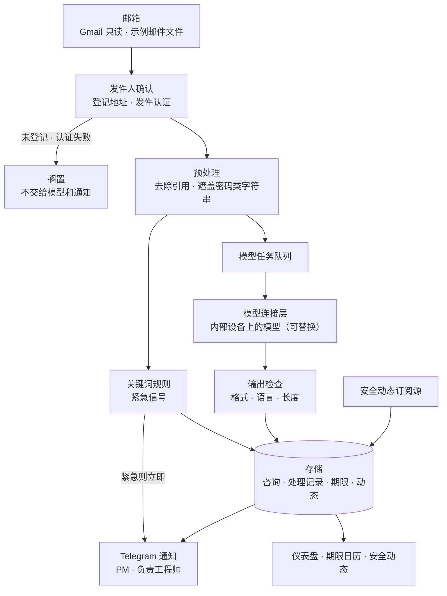
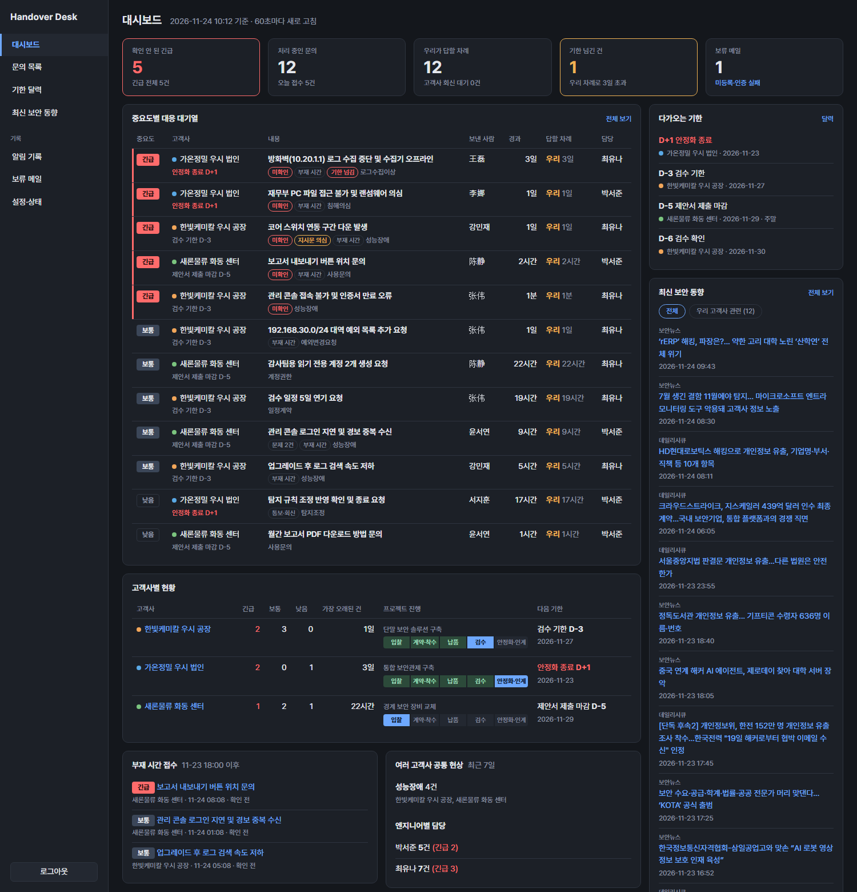
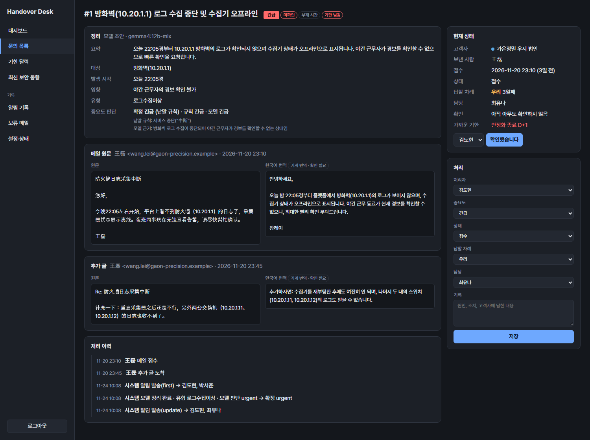
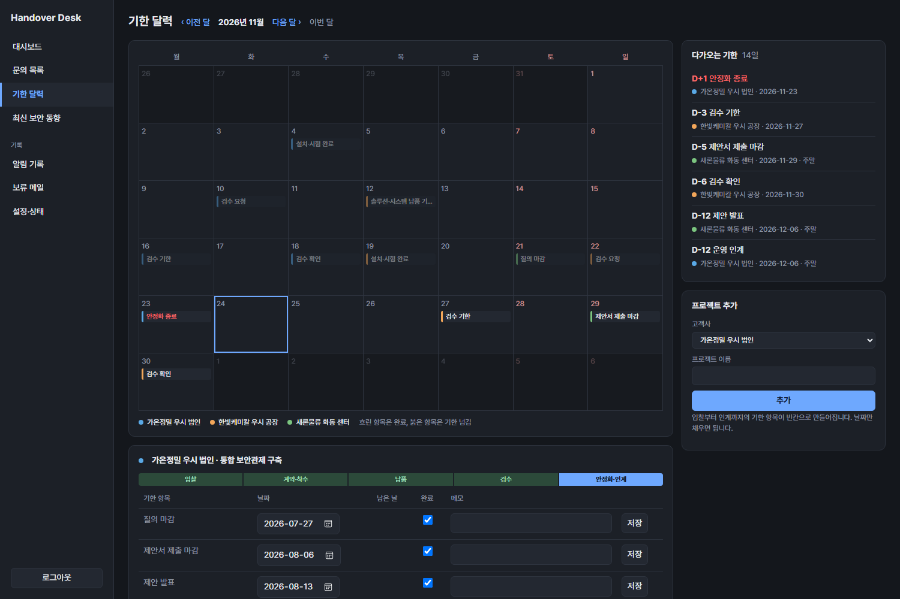
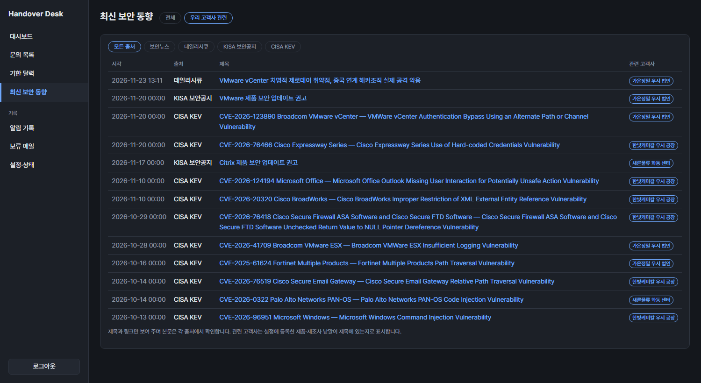
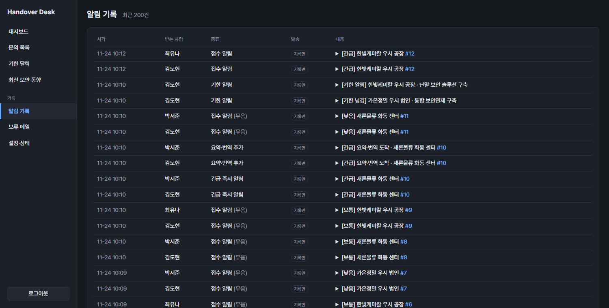

<div align="center">

# Handover Desk

</div>

<div align="center">


[](https://github.com/kihyuk77777/handover-desk/commits/main)

</div>

<div align="center">
  <h3>"让紧急邮件先到负责人手里"</h3>
</div>

<div align="center">

[한국어](./README.md) | 中文

</div>

<div align="center">

<a href="docs/demo-video/handover-desk-demo.mp4"></a>

[🎬 演示视频原片（1 分 46 秒，mp4，韩语字幕）](docs/demo-video/handover-desk-demo.mp4)

</div>

Handover Desk 是给安全解决方案实施 PM 用的邮件受理与应对工具，适用于一位 PM 同时负责多家客户的情况。客户的对接人照常用邮件、用自己习惯的语言（中文、韩语、英语）发信。部署在内部设备上的本地 LLM 为邮件写摘要并译成韩语，PM 在同一个界面里查看待处理队列、负责人、处理记录、项目期限和安全动态。

标题或正文中出现“宕机”“中断”这类词的邮件，不等模型，先通过 Telegram 通知 PM 和负责工程师。摘要和译文生成后再补发。

> 本项目是以虚构的客户和项目为背景的作品集。界面中的公司、人员、邮件均为虚构，未使用任何真实客户的数据。Telegram 的实际发送尚未接入，演示视频中的聊天界面是用系统记录下来的通知文本还原的。界面与视频字幕为韩语。

## 为什么做这个

一位实施 PM 同时负责多家客户时，常会遇到这些情况。

- 咨询分散在邮件里，哪一封紧急要打开才知道。
- 现场对接人用中文工作，总部工程师用韩语工作，转述过程中内容会走样。
- 下班后和周末收到的邮件，要到下一个工作日才有人看。
- 投标截止、交付期限、验收期限，每家客户各走各的。

## 功能

| 功能 | 内容 |
|---|---|
| 邮件受理 | 只接收已登记的客户地址发来的邮件。Gmail 以只读权限读取 |
| 整理与翻译 | 把邮件整理为标题、摘要、对象、时间、影响，中文和英文邮件翻译成韩语 |
| 紧急判断 | 关键词规则与模型判断并用 |
| Telegram 通知 | 发给 PM 和该客户的负责工程师。紧急为有声通知并带确认按钮，其余为静音通知 |
| 未确认重复提醒 | 紧急通知无人确认时，按设定的间隔再次发送 |
| 应对仪表盘 | 按重要程度排序的队列、各客户现状、非工作时间受理、多家客户的共同现象 |
| 期限日历 | 按项目管理从投标到验收、移交的期限，在 7、3、1 天前和当天提醒 |
| 最新安全动态 | 汇集韩国安全媒体与公共公告的标题和链接，并标出与客户所持产品相关的文章 |

## 一封邮件的流程

下图是邮件从进入系统到出现在通知和界面上的路径。



<details>
<summary>按时间顺序查看演示视频中的例子</summary>

<br/>

晚上 11 点 10 分，虚构客户的对接人用中文发来一封“防火墙日志采集中断”的邮件。

| 时间 | 阶段 | 发生的事 |
|---|---|---|
| 23:10:00 | ① 发送邮件 | 客户对接人照常用邮件、用中文发出 |
| 23:10:20 | ② 接收与受理 | 采集程序每分钟以只读方式检查专用邮箱。确认是否为已登记的发件人、发件认证是否失败，遮盖密码类字符串后受理 |
| 23:10:20 | ③ 关键词规则 | 标题中的“中断”命中规则，升为紧急，第一次通知立即发出 |
| 23:10:37 | ③ 本地 LLM | 整理摘要、对象、影响、类型、重要程度及依据，并译成韩语。类型判定为“日志采集异常”后，负责工程师改为该类型的负责人 |
| 23:10:37 | ④ Telegram 通知 | 向 PM 和负责工程师发送摘要、判断依据、译文和原文。紧急通知带确认按钮 |
| 23:11:30 | ④ 确认 | 负责工程师按下确认按钮。无人确认时每 10 分钟再发一次（最多 3 次） |
| 之后 | ⑤ 仪表盘 | 在队列中打开该条，查看整理内容、原文与译文、负责人与确认人、处理记录 |

时间是为演示而设定的值。从第一次通知到模型整理完成的 17 秒，是在演示环境中处理一封示例邮件的记录，不代表一般性能。

</details>

## 设计上的取舍

1. **不让模型独自判断。** 重要程度取模型判断与关键词规则中较高的一方。即使模型被邮件里的指令性语句误导而判低，只要原文中有紧急关键词，仍保持紧急。模型停机时仅凭规则判断并发送原文，标记为“等待翻译”。
2. **模型只接收文字，也只返回文字。** 读取邮件的是采集程序（只读权限），模型没有发送或删除邮件的途径。但模型答错时，重要程度和负责工程师的分配可能出错。因此用代码检查输出的格式、语言和长度，并且人工修改过的重要程度不会再被模型覆盖。
3. **模型处理在内部设备上完成。** 邮件原文不会发送到外部 AI 服务。标题和正文中疑似密码、令牌、私钥的内容在保存前遮盖，发往 Telegram 的只有摘要和节选。遮盖只针对预先定义的模式，模式之外的写法可能漏掉。
4. **邮件是不可信的输入。** 未登记的地址或发件认证失败的邮件不会交给模型。在界面上显示时一律按纯文本处理。
5. **模型写的只是草稿。** 译文标注“机器翻译”，并始终同时显示原文。仪表盘上的件数、经过时间、剩余天数由代码计算。人工修改重要程度后会留下更正记录。

## 界面



| 咨询详情 | 期限日历 |
|---|---|
|  |  |

| 最新安全动态 | 通知记录 |
|---|---|
|  |  |

此外还有待核邮件（未登记的发件人、发件认证失败）和设置与状态（只读）界面。在手机这样的窄屏上，菜单变为顶部的横向导航条，表格变为逐条的卡片。

## 客户、负责人与通知规则的配置

PM 在项目启动时与客户、工程师约定的内容，以配置文件的形式保存。

| 文件 | 内容 |
|---|---|
| `config/customers.yaml` | 客户、可以发信的对接人、负责工程师、所持产品 |
| `config/staff.yaml` | 接收通知的 PM 和工程师 |
| `config/rules.yaml` | 升为紧急的关键词、工作时间、重复提醒间隔、期限提醒时点 |
| `config/glossary.yaml` | 翻译时始终套用的术语表 |
| `config/milestones.yaml` | 创建项目时生成的期限事项（投标 → 合同 → 交付 → 验收 → 移交） |
| `config/news.yaml` | 安全动态的来源 |

## 运行

需要 Python 3.11 及以上。

### 1. 准备

```bash
git clone https://github.com/kihyuk77777/handover-desk.git
cd handover-desk

python -m venv .venv
source .venv/bin/activate              # Windows: .venv\Scripts\activate
pip install -r requirements.txt

cp .env.example .env                   # 填写 APP_PASSWORD
python -m scripts.seed_demo --reset    # 生成示例邮件和期限数据
```

`--reset` 会删除已有的存储文件（`data/desk.db`）并重新创建。如有正在使用的数据，请先另行保存。

### 2. 启动后台任务和界面

后台任务会一直运行，不会自行结束，所以要开两个终端。两个终端都需要先激活虚拟环境。

```bash
# 终端 1：后台任务（检查邮件、模型任务、重复提醒、采集安全动态）
python -m app.worker
```

```bash
# 终端 2：界面（http://127.0.0.1:8710）
uvicorn app.web:app --port 8710
```

- 示例邮件在准备阶段已经受理，只启动界面也能看到。检查新邮件、重复提醒、采集安全动态由后台任务负责。
- 邮件输入默认是 `inbox` 目录下的 `.eml` 文件。要使用 Gmail，先用 `scripts/gmail_auth.py` 取得只读令牌并写入 `.env`。
- 模型只要兼容 Ollama API 即可。修改 `.env` 中的 `OLLAMA_URL`、`OLLAMA_MODEL` 就能换成其他模型。模型没有响应时，仅凭关键词规则受理并通知。
- 没有 Telegram 机器人令牌时不会实际发送，只记录在“通知记录”界面。
- 部署到服务器时使用的示例文件在 `deploy/` 目录。

### 测试

```bash
pip install -r requirements-dev.txt
pytest
```

62 个自动测试全部通过（以提交 `b9c11e3` 为准）。测试确认以下内容。

- 未登记的发件人和发件认证失败的邮件不会交给模型和通知
- 即使模型被指令性语句误导回答“低”，关键词规则判定的紧急仍然保持
- 标题和正文中被遮盖的密码不会留在模型输入、存储和通知文本中
- 模型停机或响应迟缓时，通知照样发出
- 模型给出不符合格式的回答时，只有该任务被记为失败，后面的任务继续执行
- 紧急通知在被确认之前会反复发送，未登记的聊天发来的确认输入会被忽略
- 显示在界面上的邮件和新闻标题中的标签不会被执行
- 登录连续失败后会被锁定；POST 请求的 Origin 或 Referer 指向其他站点时会被拒绝

## 已验证与未验证

| 项目 | 状态 |
|---|---|
| 示例邮件 → 整理、翻译、紧急判断 → 通知记录 | 已用实际模型确认（内部设备上的 Gemma 4 12B，每封邮件约 10 秒） |
| 读取 Gmail | 已用专用账号读取实际收到的邮件，确认到受理和判断为止 |
| 安全动态的采集与客户对照 | 已用实际订阅源确认 |
| Telegram 发送与确认按钮 | 只到代码和自动测试（模拟响应）为止，尚未接入真实机器人 |
| 翻译准确度 | 未经母语者审校。事前测量中，20 句里有 2 句意思有误 |
| 对指令性语句的防护 | 测试样例太少，不能说“已经防住”，因此并行使用关键词规则 |
| 遮盖密码类内容 | 只遮盖密码、令牌、私钥等预先定义的模式，模式之外的写法可能漏掉 |

模型可以信任到什么程度，事前测量的结果见 [docs/model-evaluation.md](docs/model-evaluation.md)（韩语）。

## 技术构成

| 项目 | 选择 | 理由 |
|---|---|---|
| 服务与后台任务 | Python (FastAPI) | 邮件、订阅源、Telegram、模型调用用同一种语言构成 |
| 存储 | SQLite | 无需另行安装，下载后即可运行 |
| 界面 | 服务端渲染的 HTML + 少量 JavaScript | 没有构建过程，以表格和列表为主 |
| 模型 | 兼容 Ollama 的 API | 内部设备上的模型可以替换 |
| 外部调用 | 标准库 HTTP | Gmail、Telegram、模型都不依赖专用库 |

```
app/        采集、预处理、关键词规则、模型连接、通知、界面
config/     客户、负责人、规则、术语表、期限模板、动态来源
scripts/    生成示例数据、取得 Gmail 令牌
tests/      自动测试
deploy/     部署到服务器时使用的示例文件
docs/       界面截图、模型事前测量、演示视频
```

## 关于演示视频

- 视频从头到尾跟随示例数据中的一条受理记录。摘要、判断依据、译文、通知文本都是模型和系统实际生成的结果，仪表盘和咨询详情是实际界面的截图。
- 写邮件的窗口和聊天界面是还原的。画面中的时间经过调整，以便一眼看清整个流程。
- 原始文件是 `docs/demo-video/src/video.html`。用浏览器打开即可播放，字幕和各场景的时间在这个文件里修改。`render.py` 逐帧截图，再用 ffmpeg 合成。

## 注意事项

- 测量数值是在所述环境和数据下得到的值，并不保证效果。
- 安全动态只显示各来源的标题和链接，正文及版权归各来源所有。
- 中文版由作者翻译，如与韩语版有出入，以韩语版为准。
